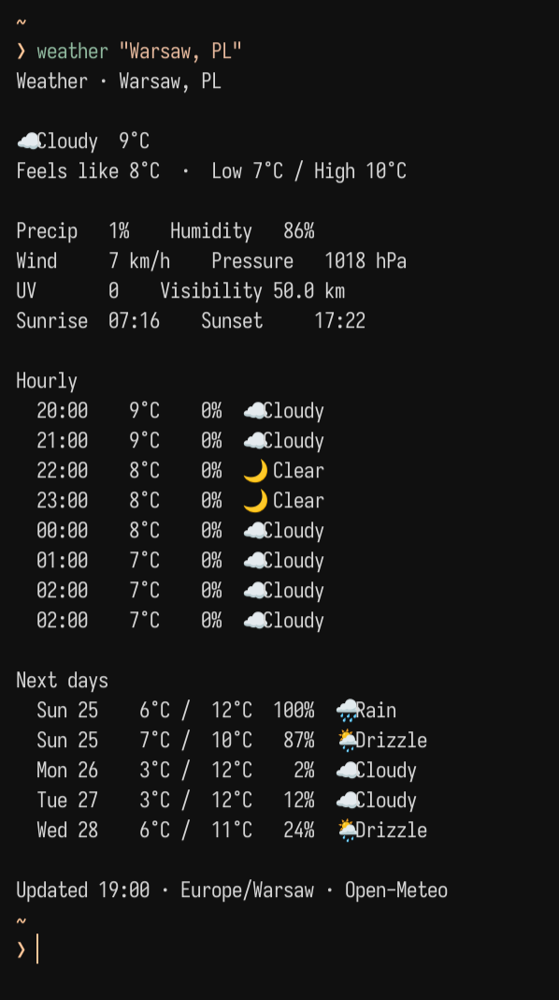

# weather

Minimal weather in your terminal. Written in Go with no external dependencies.

Current conditions, temperature and feels like, humidity, wind, sea-level pressure,
UV, visibility, sunrise and sunset. Includes the next 8 hours and 5 days with
weather emoji, temperatures and precipitation probability.



## Install

Requires Go 1.22 or newer.

```sh
go build -o weather .
install -Dm755 weather ~/.local/bin/weather
```

Make sure `~/.local/bin` is on your `PATH`.

## Usage

```sh
weather 'Warsaw, PL'
weather --city 'London, GB'
weather --no-emoji 'Berlin, DE'
weather --status 'Warsaw, PL'
weather --refresh 'Warsaw, PL'
weather --help
```

Set a default city in your shell or statusbar environment:

```sh
export WEATHER_CITY='Warsaw, PL'
weather
```

Use a country or region to distinguish cities with the same name. The first
matching location is used and displayed in the full view. All times are local to
that location. Units are Celsius, km/h, hPa and km. Percentages indicate the chance
of precipitation, including snow. `-` means data is unavailable.

Successful results are cached for 15 minutes in `$XDG_CACHE_HOME/weather`
(normally `~/.cache/weather`). `--refresh` bypasses the cache. Network errors are
written to stderr with a nonzero exit status. Expired data is not displayed.

## Statusbar

`weather --status` prints one line with conditions, temperature and city for
scripts, tmux, i3status or other bars. Set `WEATHER_CITY` or pass a city explicitly.

Waybar supports a full forecast tooltip with `--waybar`. Add `custom/weather` to
your module list and configure it:

```json
"custom/weather": {
  "exec": "weather --waybar --city 'Warsaw, PL'",
  "return-type": "json",
  "interval": 900,
  "escape": true
}
```

Add `--no-emoji` if your font does not support weather emoji.

## Data and license

Weather by [Open-Meteo](https://open-meteo.com/), location search based on
[GeoNames](https://www.geonames.org/). Data is provided under
[CC BY 4.0](https://creativecommons.org/licenses/by/4.0/). The public API requires
no key for non-commercial use. See [API terms](https://open-meteo.com/en/terms)
for usage limits and commercial use.

Code: [MIT](LICENSE), copyright 2026 [Synframe Labs](https://synframe.eu).
